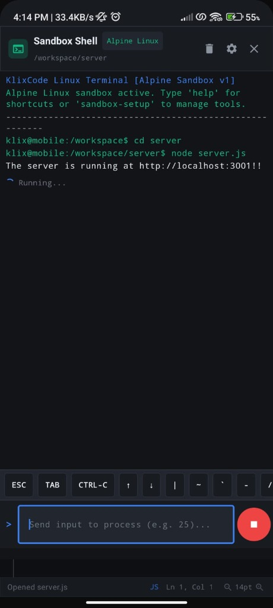
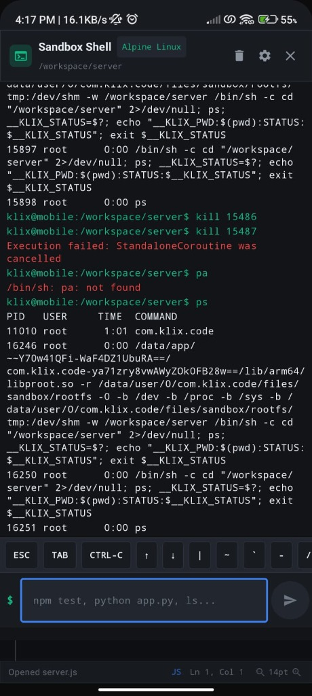
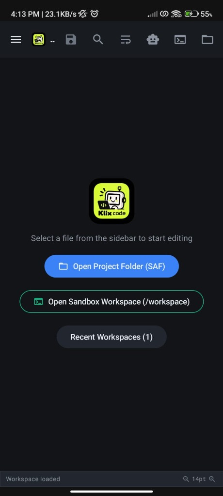
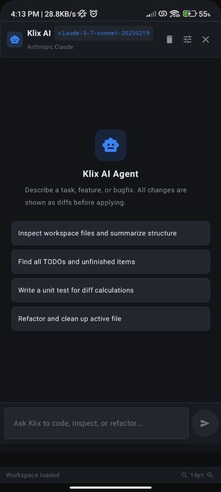
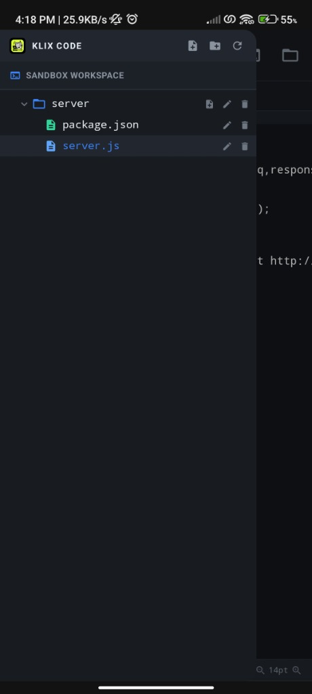
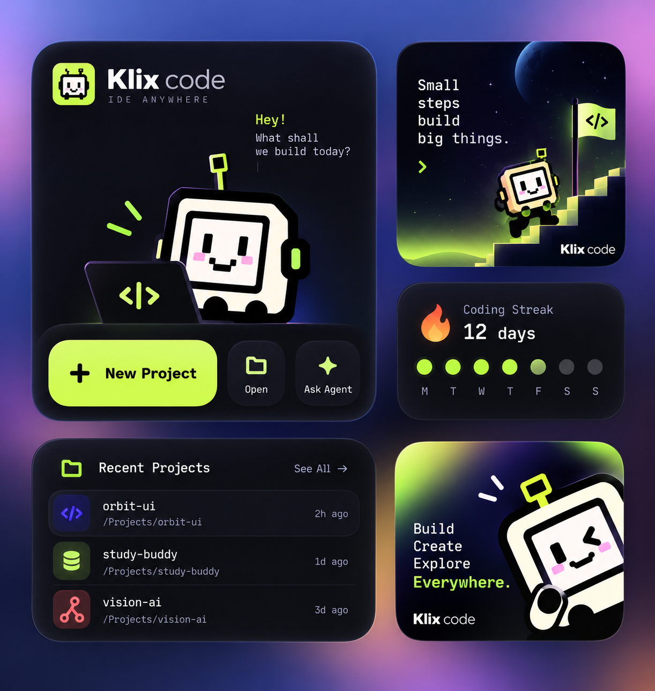
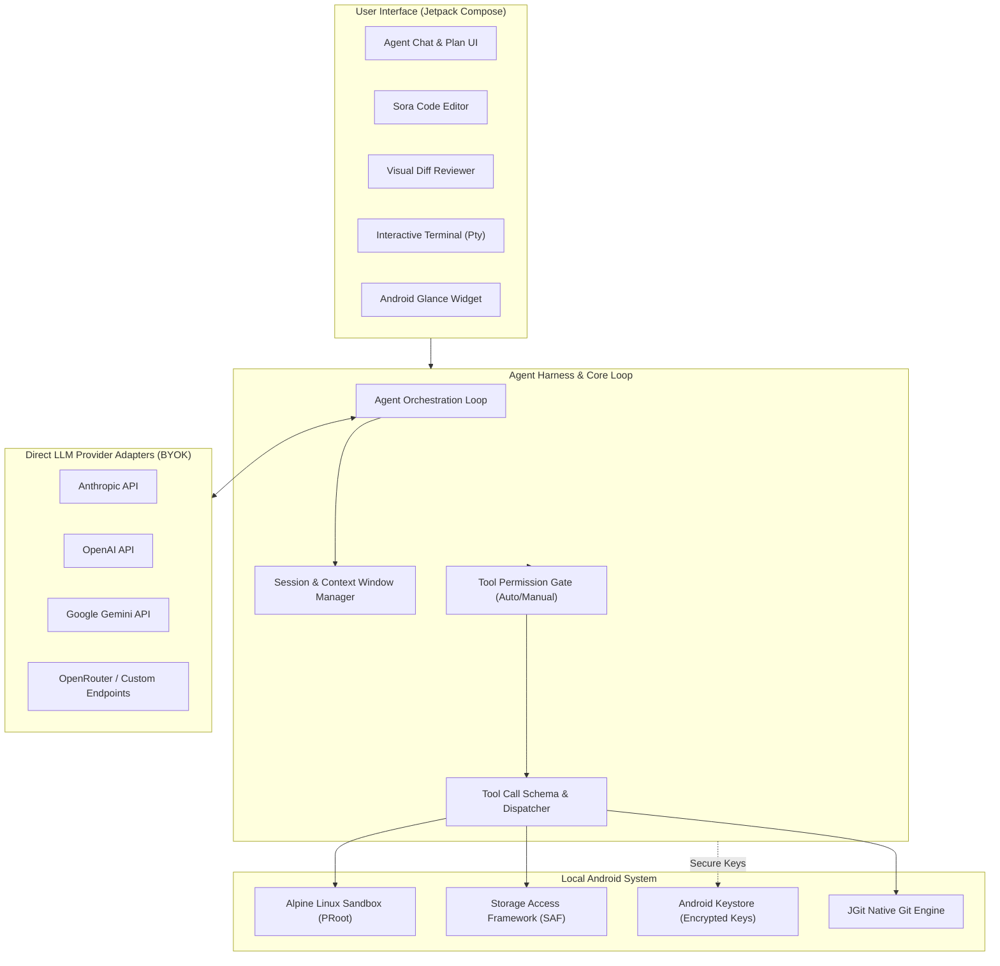

<div align="center">

  

  # Klix Code ⚡
  ### Autonomous AI Agent IDE for Android — *Cursor & Claude Code for your pocket*

  [](https://developer.android.com)
  [](https://kotlinlang.org)
  [](https://developer.android.com/jetpack/compose)
  [](https://alpinelinux.org)
  [](LICENSE)
  [](#-security--100-byok-privacy)

  <br />

  <p align="center">
    <b>Klix Code</b> is a mobile-first, native Android agentic IDE. Describe a task in plain natural language; Klix reasons, plans, inspects files, creates diffs, and executes real terminal commands inside an on-device isolated <b>Alpine Linux sandbox</b>.
  </p>

  <p align="center">
    <a href="https://klix.vercel.app/"><b>🌐 Official Website</b></a> •
    <a href="https://klix.vercel.app/klix-code-v0.2.0.apk"><b>📦 Download APK (v0.2.0)</b></a> •
    <a href="#-architecture"><b>🏗️ Architecture</b></a> •
    <a href="#-features"><b>✨ Features</b></a> •
    <a href="#-getting-started"><b>🚀 Quick Start</b></a>
  </p>

</div>

---

## 📱 Screenshots & Visual Overview

<div align="center">
  <table>
    <tr>
      <td width="33%" align="center">
        <b>🤖 Autonomous Agent Chat & Plan</b><br/><br/>
        
      </td>
      <td width="33%" align="center">
        <b>📝 Sora Code Editor & Syntax</b><br/><br/>
        
      </td>
      <td width="33%" align="center">
        <b>📊 Visual Diff & Review</b><br/><br/>
        
      </td>
    </tr>
    <tr>
      <td width="33%" align="center">
        <b>🐚 Alpine Linux Sandbox Terminal</b><br/><br/>
        
      </td>
      <td width="33%" align="center">
        <b>🔑 Multi-Provider BYOK Settings</b><br/><br/>
        
      </td>
      <td width="33%" align="center">
        <b>⚡ Home Screen Quick Widget</b><br/><br/>
        
      </td>
    </tr>
  </table>
</div>

---

## 💡 Why Klix Code?

Agentic coding tools (Cursor, Claude Code, Antigravity) revolutionized modern desktop software development: **"Describe the feature, review the diff, run tests, ship."** 

However, mobile development tools have remained stuck as simple syntax highlighters or chat wrappers without an execution runtime.

**Klix Code bridges this gap:**
- 🧠 **Autonomous Execution Loop:** Formulates multi-step plans, invokes tool operations, inspects command outputs, self-heals compiler errors, and loops until the job is done.
- 🐧 **Full On-Device Linux (PRoot Alpine):** Run `npm`, `node`, `python3`, `git`, `cargo`, or `pip` directly on Android without root or remote server dependencies.
- 🛡️ **100% BYOK (Bring Your Own Key):** Zero proxy servers. Your API requests travel directly from your phone to model providers over TLS.
- 📱 **Designed for Mobile Ergonomics:** Touch-optimized diff reviewers, collapsible panels, symbol quick bars, and homescreen Android widgets.

---

## ✨ Key Features

```
┌────────────────────────────────────────────────────────────────────────┐
│                              KLIX CODE                                 │
├────────────────────┬────────────────────┬──────────────────────────────┤
│ 🤖 Agent Engine    │ 🐧 Local Sandbox   │ 📝 Developer Ergonomics      │
│ • ReAct Tool Loop  │ • PRoot Alpine     │ • Sora TextMate Editor       │
│ • Multi-turn Plan  │ • No Root Needed   │ • Visual Diff Review         │
│ • Auto Error-Fix   │ • Node.js & Python │ • JGit Git Client            │
│ • Token Optimizer  │ • Terminal Pty     │ • Home Screen Widget         │
└────────────────────┴────────────────────┴──────────────────────────────┘
```

### 1. 🤖 Autonomous Multi-Step Agent Harness
- **ReAct Orchestration:** Executes tools sequentially (`read_file`, `write_file`, `edit_patch`, `run_command`, `git_status`, `grep_search`).
- **Plan-Then-Execute Flow:** Generates a structured execution roadmap for verification before touching code.
- **Background Execution:** Long-running builds and multi-file refactoring runs reliably in an Android Foreground Service with status notifications.

### 2. 🐧 Embedded Alpine Linux Sandbox (`PRoot`)
- Pre-configured Alpine Linux userland executing offline on your device CPU.
- Standard toolchains ready to use: `git`, `python3`, `nodejs`, `npm`, `bash`, `curl`.
- Unrooted sandboxing ensures total process containment and isolation.

### 3. 📝 Native Sora Code Editor
- High-performance code editor built on [Rosemoe/sora-editor](https://github.com/Rosemoe/sora-editor).
- TextMate & Tree-Sitter grammars for TypeScript, JavaScript, Python, Kotlin, JSON, Markdown, HTML, CSS, Rust, and Go.
- Mobile symbol keyboard, line numbering, bracket matching, and fast search/replace.

### 4. 🔀 Unified Diff & Chunk Staging
- Inspect granular side-by-side or unified colored diffs proposed by AI before writing to disk.
- Approve or reject specific chunks with a single tap.

### 5. 🛡️ 100% BYOK Privacy & Keystore Security
- Hardware-backed **Android Keystore** encryption for all API keys.
- Direct-to-provider networking via OkHttp (no third-party telemetry, proxy, or data relay).
- Supports:
  - **Anthropic** (`claude-3-7-sonnet`, `claude-3-5-sonnet`)
  - **OpenAI** (`gpt-4o`, `o3-mini`, `o1`)
  - **Google Gemini** (`gemini-2.0-flash`, `gemini-1.5-pro`)
  - **OpenRouter & OpenAI-Compatible Custom Endpoints** (DeepSeek, Groq, Ollama, vLLM)

### 6. 📱 Android Glance Homescreen Widget
- Track recent projects, prompt the agent instantly, or jump directly into active files right from your Android launcher.

---

## 🏗️ Architecture



---

## 🧰 Built-in Agent Tools

Klix Code provides a unified tool interface across all supported LLM providers:

| Tool | Description | Safety Level |
|---|---|:---:|
| `read_file` | Read line-ranges or entire files from the workspace | 🟢 Safe |
| `write_file` | Create or overwrite workspace files | 🟡 Approval Required |
| `edit_patch` | Precise surgical file edits using search & replace blocks | 🟡 Approval Required |
| `run_command` | Execute shell commands inside the Alpine Linux sandbox | 🔴 Explicit Approval |
| `grep_search` | Ripgrep-grade regex file and pattern searching | 🟢 Safe |
| `list_dir` | Explore workspace directory hierarchy and file metadata | 🟢 Safe |
| `git_status` | View staged, unstaged, and untracked file status | 🟢 Safe |
| `git_diff` | Generate unified diffs of workspace modifications | 🟢 Safe |
| `git_commit` | Commit staged changes with conventional messages | 🟡 Approval Required |

---

## 🚀 Getting Started

### 1. Download & Install
Grab the latest release APK directly from our releases or website:
- **Direct APK:** [Download Klix Code v0.2.0](https://klix.vercel.app/klix-code-v0.2.0.apk)
- **Official Web:** [https://klix.vercel.app](https://klix.vercel.app/)

> *Minimum Requirement:* Android 8.0 (API 26) or higher. Recommended: 4GB+ RAM.

### 2. Configure Your Model Provider (BYOK)
1. Open **Klix Code**.
2. Tap the **Settings (⚙️)** icon in the top right.
3. Select your provider (**Anthropic**, **OpenAI**, **Gemini**, or **Custom/OpenRouter**).
4. Paste your API key. Keys are instantly encrypted inside the on-device **Android Keystore**.

### 3. Open a Project Folder
1. Tap **Open Folder** on the home screen.
2. Grant persistent directory permission to any folder on your device or SD card via Android's Storage Access Framework.
3. Start prompting the agent to write features, diagnose bugs, or build apps!

---

## 🛠️ Building from Source

### Prerequisites
- **Android Studio Ladybug (2024.2+)** or newer
- **JDK 17** or **JDK 21**
- **Android SDK 35** (Platform tools + NDK installed)

### Build Instructions

```bash
# 1. Clone the repository
git clone https://github.com/NeuroKaran/klix_code.git
cd klix_code

# 2. Check Android SDK configuration
# Ensure local.properties points to your Android SDK:
# sdk.dir=/path/to/Android/sdk

# 3. Build debug APK
./gradlew assembleDebug

# 4. Install onto connected Android device or emulator
adb install app/build/outputs/apk/debug/app-debug.apk
```

---

## 🔒 Security & 100% BYOK Privacy

- **No Intermediate Relay:** Your source code, file structures, and prompts are transmitted solely to the AI provider endpoint you explicitly configured.
- **Zero Third-Party Telemetry:** No user analytics, no session replay scripts, and no data harvesting trackers.
- **Hardware-Backed Keystore:** API keys and credentials are never stored in plaintext SharedPreferences or SQLite databases.
- **Scoped Storage Access:** Operates strictly within user-granted directories via Android's modern Storage Access Framework (SAF).

---

## 🗺️ Roadmap

- [x] Autonomous ReAct Agent Loop
- [x] Alpine Linux Sandbox via PRoot (`npm`, `python3`, `node`)
- [x] Rosemoe Sora Editor Integration
- [x] Granular Unified Diff Review
- [x] Direct Anthropic, OpenAI, Gemini, and OpenRouter integration
- [x] Android Glance Home Screen Quick Widget
- [ ] SSH & Remote Target Execution Tier
- [ ] Android 16 Native Linux Microdroid VM support
- [ ] Language Server Protocol (LSP) diagnostics & completion over stdio
- [ ] F-Droid official packaging and repository listing

---

## 🤝 Contributing

Contributions, bug reports, and suggestions are welcome!
1. Fork the repo (`https://github.com/NeuroKaran/klix_code/fork`)
2. Create your feature branch (`git checkout -b feature/amazing-feature`)
3. Commit your changes (`git commit -m 'feat: Add amazing feature'`)
4. Push to the branch (`git push origin feature/amazing-feature`)
5. Open a Pull Request

---

## 📄 License

Distributed under the **MIT License**. See `LICENSE` for more information.

---

<div align="center">
  <sub>Built with ❤️ by <a href="https://github.com/NeuroKaran">Karan</a>. Powered by Kotlin, Compose & Open Source.</sub>
</div>
